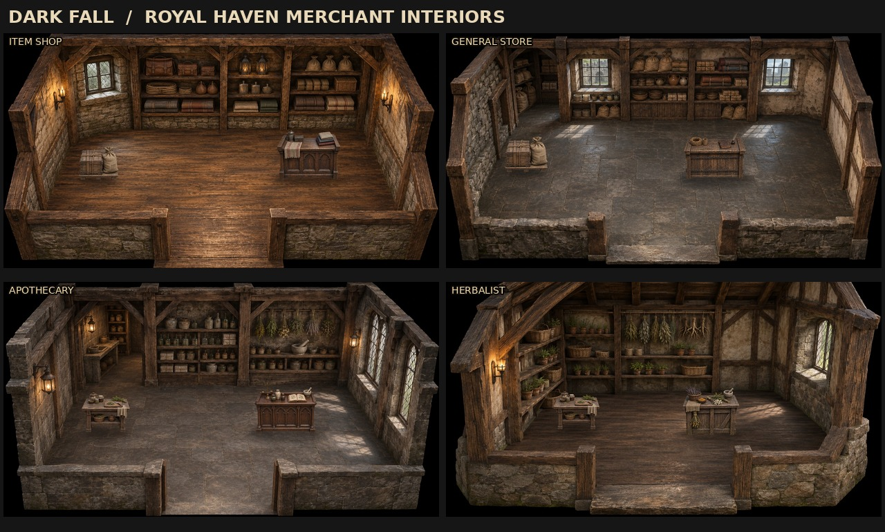

# Dark Fall V1556 — Merchant Interior Rebuild

HTML development build only. Do not publish the Android APK until requested.

## Changes

- Item Shop, General Store, Apothecary and Herbalist: distinct original, painted architectural plates with stone, timber, shelves, windows and full-width physical door thresholds.
- New depth-sorted standalone counters and supply/workstation assets; perimeter detail, clear central passageways, compact shop camera scale.
- World-coordinate floor collision, props, entrance spawns, merchant approach and thresholds mapped to the actual artwork.
- Existing day/night/dawn/dusk and merchant/NPC systems retained. Room lighting uses a restrained localized window cast and lamp glows.
- V1555's cave, crypt, catacombs and earlier landmark wing updates retained.

## Verification

Full output is 227701530 bytes (SHA-256 d5a12324a37976000394585fbd4c0f2f375d6bacc325f0347e367489ded3a673). The materializer patch rejects incorrect V1555 source/module checksums. Static project and JS preflight passed (27 scripts). VM layout audit found reachable spawn, counter, walk-out and tap exits, prop and wall blocking in all four shops; 16 landmark rooms and existing wing transitions passed again. Rendering calls were exercised with mock Canvas2D. Physical device and live browser gameplay were not tested.

To rebuild the full game locally, run `python3 scripts/materialize_game.py` in this branch. This branch is an HTML development backup, not an Android release.
