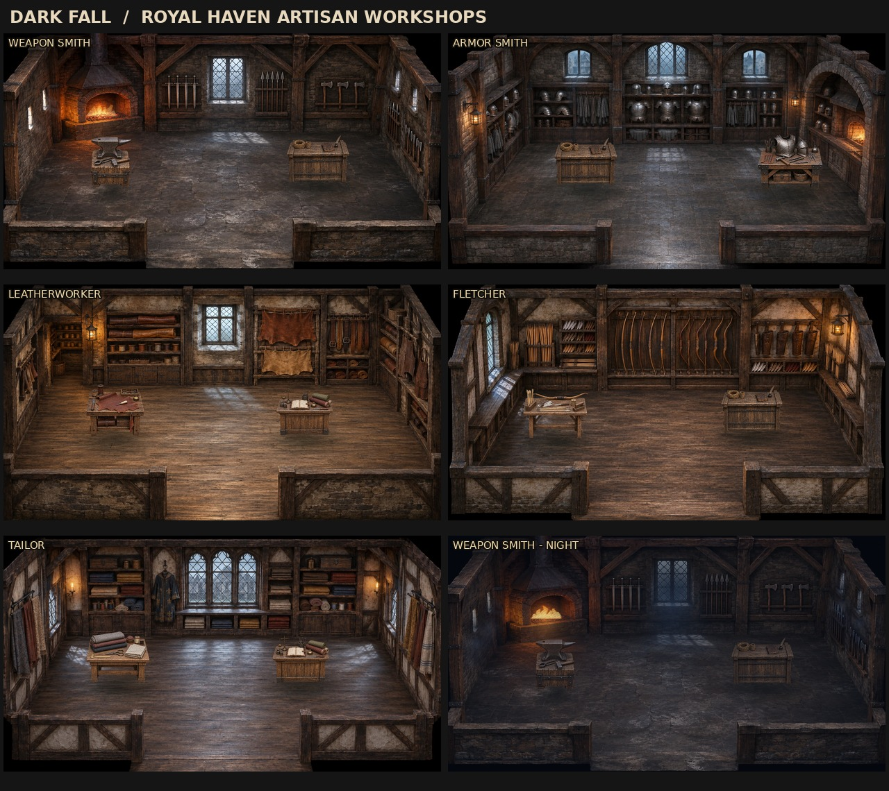

# Dark Fall V1557 — Artisan Workshop Rebuild

Standalone HTML development build. Do not publish an Android APK until requested.

## Changes

- Weapon Smith, Armor Smith, Leatherworker, Fletcher and Tailor each receive original, independent architectural artwork and workstation props, with material detail, trade-specific wall stock and clear entrance aisles.
- Full physical carved stone/wood thresholds, art-mapped walkable polygons, furniture and NPC collision, compact room cameras and depth-sorted actor/prop coordinates.
- Existing merchant inventory/dialogue, original character sprites and worker roles retained. Animated forge flames are restricted to actual fireboxes; the city daylight cycle remains intact.
- Shared 2-room background cache. Slow-decoding images use the previous room for that visit, rather than changing collision geometry while moving.
- All previous V1556 merchants, cave rooms and landmark wing work retained.

## Validation

Full output: 231375473 bytes, SHA-256 214b7b8dfca36528e1cbebe88f858d076dce485fe08f3512d9f51c57afb4ad3c. Verified V1556 source and patch output. Static project and 27-script JS preflight passed. VM regression checked 16 landmark rooms, 4 recently rebuilt merchants, and all 5 artisan workshops: reachable entrance, counters and workstations, automatic/tap exits, wall/prop/NPC collision and decode admission. All 5 workshops rendered against actual decoded art via Canvas2D under day/dawn/dusk/night; existing NPC and party sprites were not drawn in that art-only check. Full interactive browser and device testing remain outstanding.

Rebuild locally with `python3 scripts/materialize_game.py`. This is a development backup and not an Android release.
