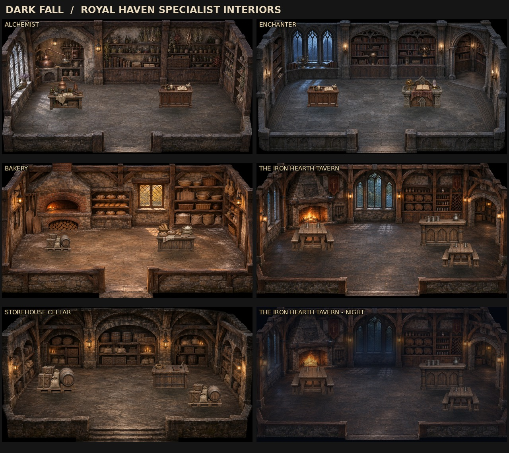

# Dark Fall V1558 — Specialist Interior Rebuild

HTML development backup only; do not publish Android updates until requested.

## Changes

- All-new Alchemist, Enchanter, Bakery, Iron Hearth Tavern and Storehouse Cellar backgrounds and new freestanding workbench/counter/storage sprites.
- Tavern enlarged relative to compact shops with fireplace, seating and open central path; cellar's entrance is an actual stair threshold, with stable underground lantern illumination and restrained day-dependent threshold light.
- Bakery and tavern have a subtle animated hearth, enchanter has a restrained crystal reflection, and other aboveground rooms use the city day/dawn/dusk/night cycle.
- Art-mapped walkable floor geometry, depth-sorted furniture and original characters, collision and merchant approach points. Corrected tavern frontal bar access during testing.
- Existing merchant behavior, inventory, NPC sprites, previous rooms, and Android release retained. Uses existing maximum two cached background surfaces and safe image-decode admission.

## Verification

Full HTML 235259045 bytes, SHA-256 365f636a85780174929d74a17eb54d01bc9d577d00e44f50588967ec85a1bfee. Exact V1557 source and V1558 result hashes verified. Static project validation and 27-script JavaScript preflight passed. Navigation audit passed for 16 landmark rooms, 4 V1556 merchant rooms and 10 V1557/V1558 workshops/specialist rooms, including counter/front approaches, furniture blocking, tap and automatic exits, and safe fallback on slow decoding. Canvas2D tested real decoded artwork in all five new rooms under the four lighting phases; NPC/party sprites omitted from art-only rendering. Interactive browser and phone gameplay remain untested.

Rebuild with `python3 scripts/materialize_game.py`. This branch is intentionally separate from the release branch.
